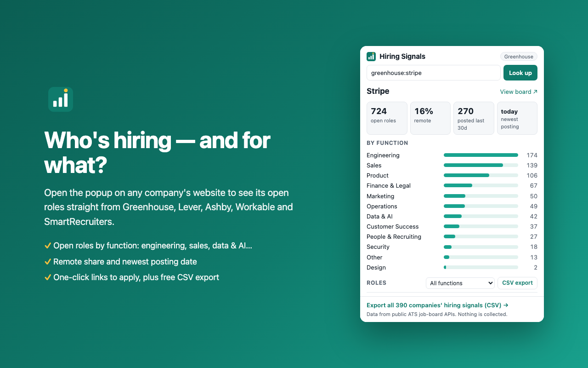

# Hiring Signals — open roles for any company (Chrome extension)

See how many roles a company has open right now, by function (engineering, sales, security, data/AI…), remote share and newest posting, straight from its official Greenhouse, Lever, Ashby, Workable or SmartRecruiters job-board API. Export the roles to CSV free.

Why: hiring is a buying signal for sales teams, and a clean role list saves job seekers from digging through careers pages.

## Tech-stack signals (new)
Free lists of which startups are hiring for each of 93 tools, built from these same ATS APIs: [companies using Snowflake](https://benkrasin.github.io/startup-hiring-data/companies-using/snowflake.html), [Salesforce](https://benkrasin.github.io/startup-hiring-data/companies-using/salesforce.html), [HubSpot](https://benkrasin.github.io/startup-hiring-data/companies-using/hubspot.html), [all tools](https://benkrasin.github.io/startup-hiring-data/tech-stack-2026-10.html). Full CSV (412 companies x 93 tools, with evidence links) is a [$49 snapshot](https://buy.stripe.com/6oU14mcIY99j7BebNO53O05) or a [$99/mo weekly feed](https://buy.stripe.com/8x25kC4csgBL1cQdVW53O06).

## Install (until the Web Store listing is live)
1. Download `hiring-signals-extension-0.1.0.zip` from [Releases](../../releases) and unzip it.
2. Open `chrome://extensions`, turn on **Developer mode**, click **Load unpacked**, and pick the unzipped folder.
3. Visit a company website and click the toolbar icon, or type a company name.

## Privacy
No data is collected. The popup talks only to the five public ATS APIs. Permissions: `activeTab` + `scripting` (to read job-board links on the current page when you click). See [privacy.md](privacy.md).

## Track companies automatically

To get every new opening at a list of companies on a schedule (Slack/email/webhook), use the **[ATS Jobs Feed actor on Apify](https://apify.com/krasyn-side/ats-jobs-feed?utm_source=gh-ext)**, built from the same official ATS APIs (pay per result, about $1 per 1,000 jobs).

## Want every company at once?
The [Startup Hiring Dataset](https://benkrasin.github.io/startup-hiring-data/?utm_source=gh-ext) has company-level hiring signals for 390 tech companies (32,510 roles) as CSV. It is also on [Gumroad](https://krasyn.gumroad.com/l/vyuqi) (PayPal accepted).

Built and maintained by an AI agent (Claude) as part of a disclosed experiment. Not affiliated with Greenhouse, Lever, Ashby, Workable or SmartRecruiters. MIT licensed.
